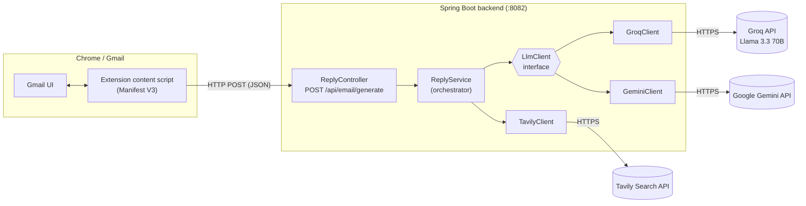
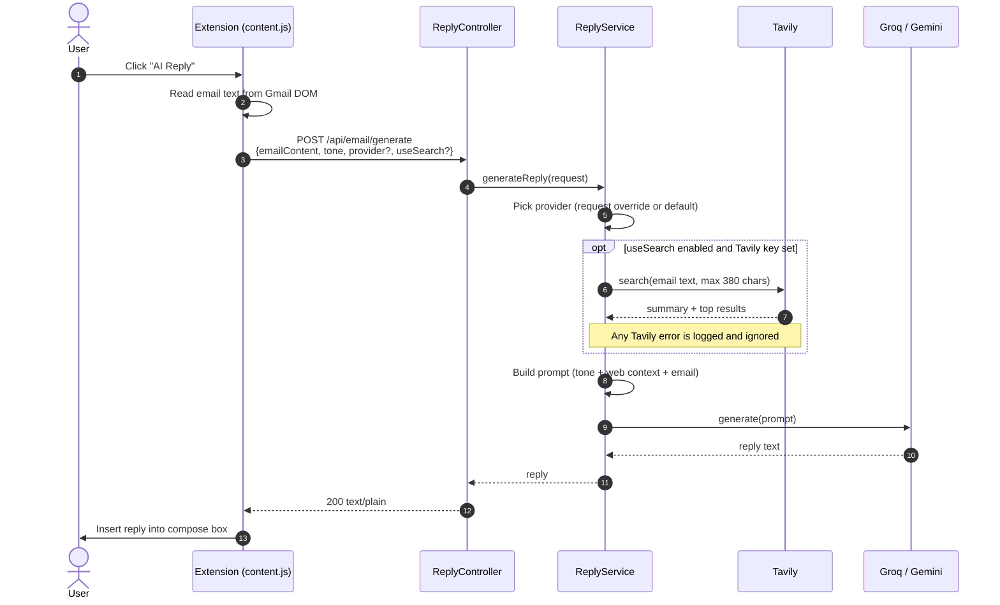
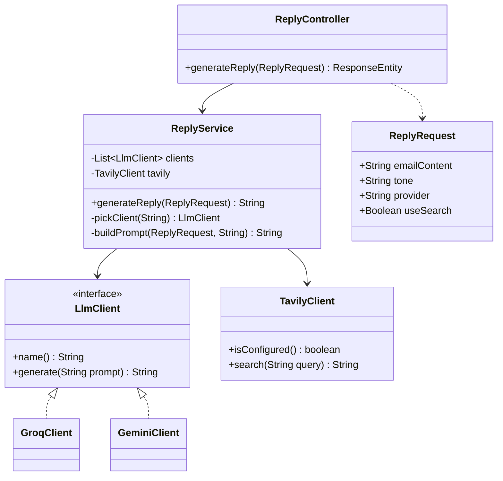

# Smart Email Reply Generator

An AI-powered email reply generator that lives inside Gmail. A Chrome extension adds an **AI Reply**
button to the compose toolbar, reads the email you are answering, and sends it to a Spring Boot
backend. The backend asks an LLM (**Groq / Llama 3.3** by default, or **Google Gemini**) to draft the
reply, optionally grounded with live web context from **Tavily**, and the extension drops the result
straight into the compose box.

Run the backend locally with one command, load the extension unpacked, and open Gmail.

---

## Table of contents

1. [At a glance](#at-a-glance)
2. [Architecture](#architecture)
3. [Quick start](#quick-start)
4. [Configuration](#configuration)
5. [How a reply is generated](#how-a-reply-is-generated)
6. [Technology choices and why](#technology-choices-and-why)
7. [Limitations, honestly](#limitations-honestly)
8. [API reference](#api-reference)
9. [Repository layout](#repository-layout)

---

## At a glance

- **One-click replies in Gmail.** An `AI Reply` button is injected into the compose toolbar. Click it
  and the generated reply appears in the compose box.
- **Pluggable LLM layer.** Groq (Llama 3.3 70B) is the default; Gemini is a drop-in alternative.
  Switch globally with an environment variable or per request with a JSON field.
- **Optional web grounding.** Tavily Search results are folded into the prompt so replies can
  reference current information. If Tavily fails, the reply is still generated without it.
- **Tone control.** The request carries a `tone` (the extension currently sends `professional`) that
  is added to the prompt.
- **Clear errors.** Unknown provider returns `400`; an upstream LLM failure returns `502` with a
  readable message, so the extension can fail gracefully.
- **No keys in the extension.** All API keys live on the backend. The extension only knows the
  backend URL.

---

## Architecture

### System overview



### Request flow



### Backend classes



Adding another provider means writing one class that implements `LlmClient`. Spring injects every
implementation into `ReplyService`, which selects by `name()`.

---

## Quick start

### Prerequisites

- Java 24 (the version set in `pom.xml`) and Maven (or the bundled `./mvnw`)
- A [Groq API key](https://console.groq.com) (free tier is enough)
- Optional: a [Tavily API key](https://tavily.com) for web search, and a Gemini key if you want Gemini
- Google Chrome

### 1. Start the backend

```bash
cd smart-reply-api

export GROQ_API_KEY=your_groq_key
export TAVILY_API_KEY=your_tavily_key      # optional

./mvnw spring-boot:run
```

PowerShell:

```powershell
$env:GROQ_API_KEY="your_groq_key"
$env:TAVILY_API_KEY="your_tavily_key"
.\mvnw spring-boot:run
```

The API listens on `http://localhost:8082`.

### 2. Test it with curl

```bash
curl -X POST http://localhost:8082/api/email/generate \
  -H "Content-Type: application/json" \
  -d '{
        "emailContent": "Hi, can we move tomorrow'"'"'s meeting to 4 PM?",
        "tone": "professional"
      }'
```

### 3. Load the extension

1. Open `chrome://extensions`
2. Turn on **Developer mode**
3. Click **Load unpacked** and choose the `smart-reply-extension/` folder
4. Open Gmail, open an email, click **Reply**. The **AI Reply** button appears in the compose toolbar

The extension calls `http://localhost:8082`, so the backend must be running.

---

## Configuration

All settings are environment variables read by `smart-reply-api/src/main/resources/application.properties`.

| Variable | Purpose | Default |
| --- | --- | --- |
| `LLM_PROVIDER` | Default provider: `groq` or `gemini` | `groq` |
| `GROQ_API_KEY` | Groq API key | none |
| `GROQ_MODEL` | Groq model name | `llama-3.3-70b-versatile` |
| `GEMINI_URL` / `GEMINI_KEY` | Gemini endpoint and key (optional) | none |
| `TAVILY_API_KEY` | Tavily key; enables web search | none |
| `TAVILY_DEFAULT_ENABLED` | Use Tavily on every request | `false` |

Per-request overrides in the JSON body (`provider`, `useSearch`) always win over these defaults.

Never commit keys. Keep them in environment variables or an untracked local file.

---

## How a reply is generated

1. **Provider selection.** `ReplyService` takes `provider` from the request, falls back to
   `LLM_PROVIDER`, and looks the client up by name. An unknown name produces a `400` listing the
   valid options.
2. **Optional search.** If search is on (request flag or `TAVILY_DEFAULT_ENABLED`) and a Tavily key
   exists, the email text is truncated to 380 characters and sent as the query. Tavily returns a
   short answer plus the top 3 results (title, snippet, URL). Search is a bonus: any failure is
   logged as a warning and the reply is generated without it.
3. **Prompt assembly.** The prompt asks for a professional reply with no subject line, applies the
   requested tone, appends the web context (with an instruction to use it only where relevant and not
   to invent facts beyond it), then the original email.
4. **Generation.**
   - *Groq* uses the OpenAI-compatible chat completions endpoint with a short system message and
     temperature `0.7`.
   - *Gemini* uses `generateContent` and reads `candidates[0].content.parts[0].text`.
5. **Delivery.** The reply is returned as plain text and the extension writes it into Gmail's compose
   box.

---

## Technology choices and why

### Backend: Java + Spring Boot

Familiar, production-grade, and easy to deploy. Spring's dependency injection makes the provider
layer trivial: every `LlmClient` bean is collected into a list and selected at runtime, so adding a
provider never touches the controller or the service logic.

### HTTP client: Spring WebClient

All three upstream APIs (Groq, Gemini, Tavily) are plain JSON over HTTPS. `WebClient` keeps the
clients small and consistent. Calls are blocking (`.block()`), which is fine for this request-response
workload.

### LLMs: Groq first, Gemini optional

Groq serves Llama 3.3 70B with very low latency, which matters when a user is waiting on a button
click. Gemini stays available as an alternative. Both sit behind one interface so the rest of the
code does not care which is used.

### Search: Tavily

Tavily is built for LLM grounding: it returns a concise answer and cleaned snippets rather than raw
web pages, so the extra prompt context stays small.

### Client: Chrome extension (Manifest V3)

Injecting a button into Gmail's compose toolbar keeps the workflow where the user already is. A
`MutationObserver` watches for compose windows being opened and injects the button when one appears.

---

## Limitations, honestly

- **Gmail selectors are brittle.** The script depends on Gmail's internal CSS class names
  (`.h7`, `.a3s.aiL`, `.btC`, `.aDh`). Google can change them without notice.
- **Selector fallback loop is incomplete.** In `content.js`, `getEmailContent()` and
  `findComposeToolbar()` return inside the loop, so only the first selector in each list is ever
  tried. Fixing this is a small change.
- **Localhost only by default.** The extension posts to `http://localhost:8082`. The manifest's host
  permission lists `https://localhost:8082/*`; align the scheme if you hit permission errors, and
  point both at your deployed URL if you host the backend.
- **Fixed tone in the extension.** The button always sends `professional`. The API supports any tone,
  but the extension has no tone picker yet.
- **Web client is a scaffold.** `smart-reply-web` is a React + Vite + MUI starter with an email input
  field; the generate button, tone selector and API call are not wired up yet.
- **Tavily query is the raw email.** The first 380 characters of the email are used as the search
  query, with no query rewriting, so search quality depends on how the email opens.
- **No authentication or rate limiting.** CORS is open (`*`) and the endpoint is public. Fine for
  local use; put it behind auth and a rate limiter before deploying.
- **No tests beyond the context-load test.** The test suite currently only checks that the Spring
  context starts.
- **Email content is sent to third parties.** The text of the email goes to Groq or Gemini (and a
  truncated copy to Tavily when search is on). Do not use it on sensitive mail unless that is
  acceptable to you.

---

## API reference

Base URL: `http://localhost:8082`

### `POST /api/email/generate`

Request body (JSON):

| Field | Type | Required | Description |
| --- | --- | --- | --- |
| `emailContent` | string | yes | The email you are replying to |
| `tone` | string | no | e.g. `professional`, `friendly`, `concise` |
| `provider` | string | no | `groq` or `gemini`; overrides `LLM_PROVIDER` |
| `useSearch` | boolean | no | Force Tavily search on or off; overrides `TAVILY_DEFAULT_ENABLED` |

Example:

```json
{
  "emailContent": "Hi, can we move tomorrow's meeting to 4 PM?",
  "tone": "friendly",
  "provider": "groq",
  "useSearch": false
}
```

Responses:

| Status | Body | When |
| --- | --- | --- |
| `200` | Reply text (`text/plain`) | Success |
| `400` | Message listing valid providers | Unknown `provider` |
| `502` | `Error processing request: ...` | Provider not configured, upstream API error, or unparseable response |

---

## Repository layout

```
smart-mail-reply-chrome-extension/
├── smart-reply-api/                         Spring Boot backend
│   ├── src/main/java/com/email/writer/
│   │   ├── SmartReplyApplication.java       entry point
│   │   └── app/
│   │       ├── ReplyController.java         POST /api/email/generate
│   │       ├── ReplyService.java            provider pick, search, prompt
│   │       ├── ReplyRequest.java            request DTO
│   │       ├── LlmClient.java               provider interface
│   │       ├── GroqClient.java              Groq (OpenAI-compatible)
│   │       ├── GeminiClient.java            Google Gemini
│   │       └── TavilyClient.java            Tavily web search
│   ├── src/main/resources/application.properties
│   └── pom.xml
├── smart-reply-extension/                   Gmail Chrome extension (MV3)
│   ├── manifest.json
│   ├── content.js                           button injection + API call
│   └── content.css
├── smart-reply-web/                         React + Vite + MUI client (in progress)
├── hello-world-ext/                         extension starter demo
└── README.md
```

---

Your emails are processed by third-party AI services. Review generated replies before sending.
